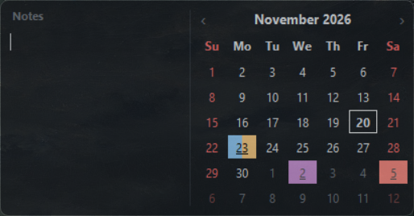

# Desktop Calendar

A tiny, offline calendar with a notes panel that lives on your Windows desktop.

It sits behind your open programs, so it never covers your work. When you go to the desktop and nothing is in the way, it shows on top. It starts automatically when you log in.

## Features

- **Fully offline:** no internet and no account. Everything is saved locally.
- **Stays on the desktop:** it hides behind your programs, can't be minimised, has no taskbar button, and Alt+F4 doesn't close it. Clicking the desktop or switching virtual desktops won't pull it over open windows.
- **Starts with Windows** automatically.
- **Several events per day,** each with its own colour. A day with several colours shows them as stripes.
- **Hover a day** to see all its events.
- **Shows the previous and next month's days** faded, and you can click them too.
- **Weekends in red:** Saturday and Sunday stand out.
- **Week starts on Monday or Sunday** (right-click → Week starts on).
- **Drag to move it.** It remembers where you put it.
- **Adjustable:** transparency (100% to 50%), size (Tiny to Large) and theme (Dark or Light).
- **Frosted glass look (optional):** right-click → Blur background.
- **Month / year picker:** click the month title to pick a month, click again to pick a year.
- **Notes panel** next to the calendar. It saves as you type (right-click → Show notes to hide it).
- **Lightweight:** one Python file using only the standard library.

## Requirements

- Windows 10 or 11
- [Python 3](https://www.python.org/downloads/). During install, tick **"Add Python to PATH"**.

## Install

1. Download this repository: **Code → Download ZIP**, then unzip it.
2. Put the folder somewhere permanent, for example `Documents\DesktopCalendar`.
3. Double-click **`install_windows.bat`**.

The calendar appears in the top-right corner and will start every time you log in.

> If you move the folder later, double-click `calendar_desktop.pyw` once from its new place to update auto-start.

## How to use

| Action | How |
|---|---|
| Add or edit events | Click a date. Type a name, pick a colour, and use **+ Add event** for more. Press **Enter** to save. |
| See events | Hover over a date. Dates with named events have an underlined number. |
| Change month | Click `‹` or `›` |
| Jump to a month or year | Click the month title (once = months, twice = years) |
| Write notes | Click the Notes panel and type. Saved automatically. |
| Move the calendar | Drag the month title, the bar around it, or the Notes heading |
| Settings | Right-click anywhere on the calendar: Show notes, Blur background, Transparency, Size, Theme, Week starts on, Move back to top-right |
| Close | Right-click → **Exit**. It starts again at next login. |
| Stop auto-start | Right-click → **Exit and turn off auto-start** |

## Where your data is stored

Data is kept in your user folder (`C:\Users\<you>\`):

- `desktop_calendar_data.json` holds your events and settings.
- `desktop_calendar_notes.txt` holds your notes.
- `desktop_calendar_error.log` holds error messages, only if something goes wrong. It's capped at 200 KB.

To back up, copy `desktop_calendar_data.json` and `desktop_calendar_notes.txt`.

## Uninstall

Double-click **`uninstall_windows.bat`**. It closes the calendar, removes auto-start and deletes the program files. It asks before deleting your saved events and notes.

## macOS

`install_mac.command` makes it start at login. On macOS it's a normal small window, without the stay-behind-programs behaviour that Windows has.

## License

[MIT](LICENSE)
